[简体中文](README.md) | **繁體中文** | [English](README.en.md)

# Mini-IM

[](https://github.com/kite88/mini-im/releases/latest)
[](LICENSE)

Go + Gin + GORM(PostgreSQL) + Redis 實現的即時通訊 / 客服系統。
前端是原生 Vue 2 + Axios 靜態頁，由後端直接託管，不需要單獨構建。
同一套頁面響應式適配 PC 與手機，無構建流程、無外部圖片資源。

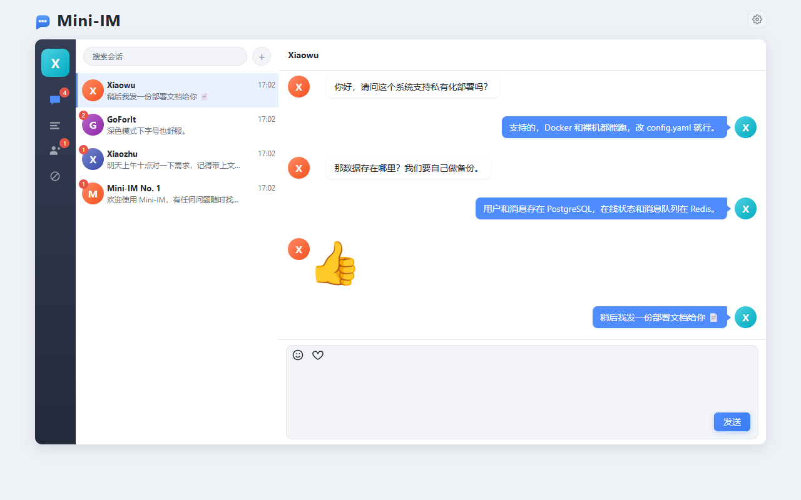

---

## 目錄

- [介面預覽](#介面預覽)
- [快速開始](#快速開始)
- [功能演示](#功能演示)
- [介面](#介面)
- [端到端迴歸](#端到端迴歸)
- [專案結構](#專案結構)
- [資料表](#資料表)
- [Redis key](#redis-key)
- [設計要點](#設計要點)
- [部署提示](#部署提示)
- [更新日誌](#更新日誌)
- [許可](#許可)

---

## 介面預覽

> 下面的截圖都取自 `config.example.yaml` 中 `seed` 段寫入的演示賬號（Mini-IM No. 1 / Xiaoha / Xiaowu / Xiaozhu / GoForIt），
> 把 `seed.enabled` 改成 `true` 重啟即可得到完全一致的初始資料。

### PC 端

| 會話列表（含未讀角標） | 聊天視窗 |
| --- | --- |
| 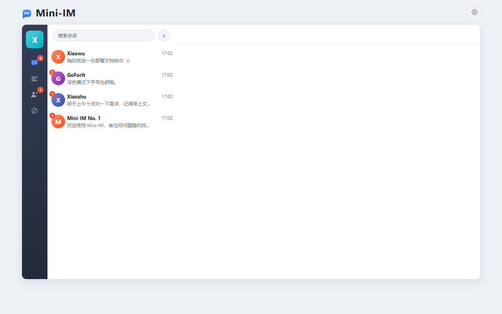 |  |

| 搜尋使用者 / 發起好友申請 | 黑名單 |
| --- | --- |
| 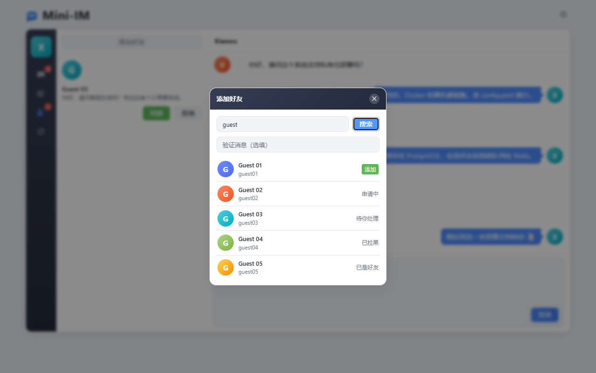 | 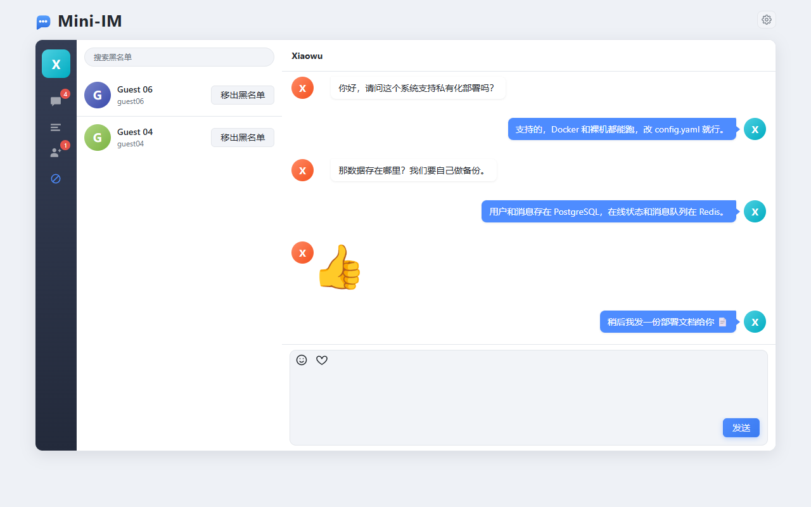 |

### 手機端

| 登入 | 會話列表 | 聊天 | 設定 |
| --- | --- | --- | --- |
| 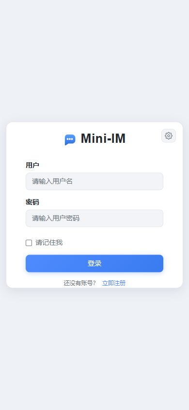 | 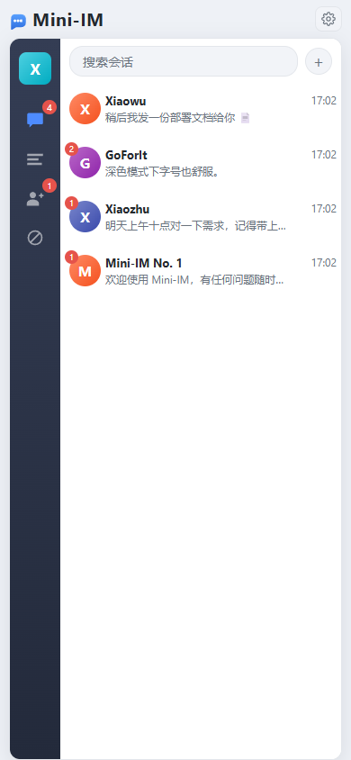 | 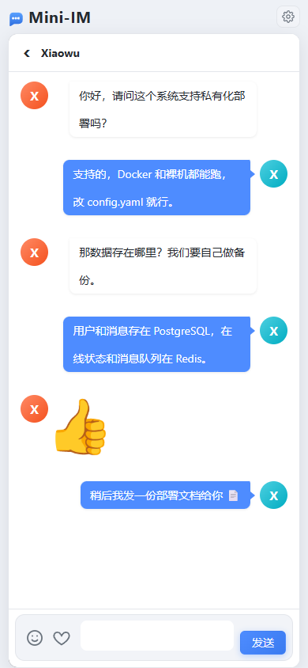 | 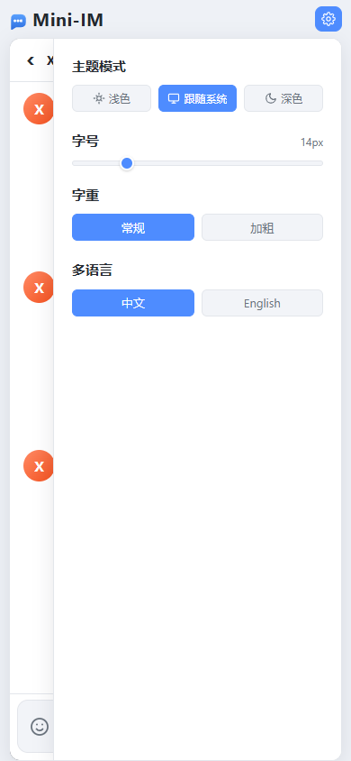 |

### 深色主題 / 多語言

| PC 端深色 | 手機端深色 | English |
| --- | --- | --- |
| 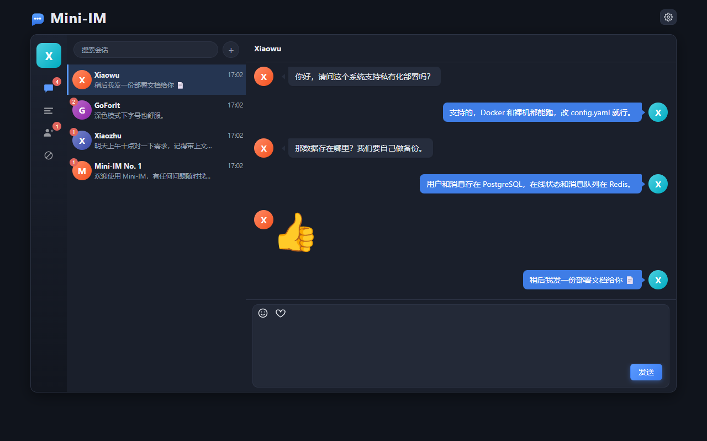 | 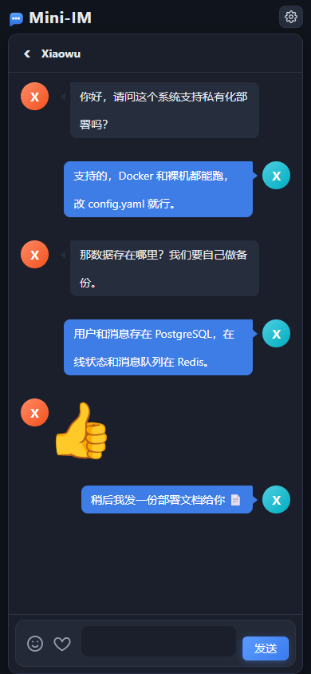 |  |

---

## 快速開始

```bash
docker compose up -d          # 啟動 PostgreSQL + Redis（本機已有例項時跳過）
go run .                      # 啟動服務
```

> 目錄裡沒有 `config.yaml` 時會先進入[初始化配置嚮導](#初始化配置嚮導)：瀏覽器開啟
> <http://localhost:8280/setup> 填好資料庫 / Redis 並儲存，服務隨即自動啟動；
> 也可以先 `cp config.example.yaml config.yaml` 改好配置再啟動（`config.yaml` 是本地檔案、不入庫）。

開啟 <http://127.0.0.1:8280/>，會自動跳轉到 `/web/index.html`；
未登入時前端會引導到 `/web/login.html`，註冊或登入後進入聊天頁。

新庫是空的，直接在登入頁註冊賬號即可（使用者名稱 6-20 位字母、數字、下劃線或減號，密碼至少 6 位），
再透過左側「新的朋友 → 新增好友」按賬號或暱稱搜尋、發起申請，對方同意後即可互發訊息。

### 演示賬號（預設不建立）

`config.example.yaml`（以及由它寫出的 `config.yaml`）裡 `seed.enabled` 預設是 `false`。改成 `true` 後重啟，會寫入下面這組賬號，
並**兩兩互加好友**，開箱即可互發訊息，密碼取 `seed.password`（預設 `123123`）：

| 賬號 | 暱稱 |
| --- | --- |
| `mini-im-1` | Mini-IM No. 1 |
| `mini-im-2` | Mini-IM No. 2 |
| `mini-im-3` | Mini-IM No. 3 |
| `ha1234` | Xiaoha |
| `wu1234` | Xiaowu |
| `zhu333` | Xiaozhu |
| `goforit` | GoForIt |

賬號名與暱稱都在本地 `config.yaml` 的 `seed.accounts` 裡，按需增刪即可：

```yaml
seed:
  enabled: false            # 改成 true 後重啟生效
  password: "123123"
  accounts:
    - { username: mini-im-1,  nickname: Mini-IM No. 1 }
    - { username: mini-im-2,  nickname: Mini-IM No. 2 }
    - { username: mini-im-3,  nickname: Mini-IM No. 3 }
    - { username: ha1234,  nickname: Xiaoha }
    - { username: wu1234,  nickname: Xiaowu }
    - { username: zhu333,  nickname: Xiaozhu }
    - { username: goforit,  nickname: GoForIt }
```

初始化是冪等的：賬號已存在時只補齊暱稱與頭像，不覆蓋密碼，重複啟動安全。
演示賬號由 seed 直接寫庫，繞過了註冊介面的校驗，因此不受註冊規則（使用者名稱 6-20 位）限制。

### 前置條件

- Go 1.23+
- PostgreSQL（庫需先存在，表由 GORM 自動遷移）
- Redis

不使用 `docker compose` 時，手工建庫即可：

```sql
CREATE DATABASE "mini-im" ENCODING 'UTF8';
```

### 配置

`config.yaml` 是**本地檔案、不入庫**：倉庫裡只帶模板 `config.example.yaml`，首次啟動沒有 `config.yaml`
時由[初始化配置嚮導](#初始化配置嚮導)按模板寫出，也可以自己 `cp config.example.yaml config.yaml` 後修改。
`.gitignore` 已忽略 `config.yaml` 與嚮導重配時的備份 `config.yaml.bak`，兩者都不要提交。

模板預設值：PostgreSQL `127.0.0.1:5432` / `postgres` / `123456` / 庫 `mini-im`，
Redis `127.0.0.1:6379` DB `1`，HTTP 埠 `8280`。
`app.name`（預設 `mini-im`）同時作為 Redis key 的字首，改它等於換一套快取名稱空間。

除 `seed.*` 外的配置都能用環境變數覆蓋，容器部署時無需改檔案：

```bash
IM_PG_HOST=pg IM_PG_PASSWORD=secret IM_REDIS_ADDR=redis:6379 IM_JWT_SECRET=xxx go run .
```

<details>
<summary>全部環境變數</summary>

| 變數 | 說明 |
| --- | --- |
| `IM_APP_NAME` | 應用名，同時作為 Redis key 字首 |
| `IM_HTTP_PORT` / `IM_RUN_MODE` / `IM_WEB_DIR` | 埠、模式、靜態資源目錄 |
| `IM_PG_HOST` `IM_PG_PORT` `IM_PG_USER` `IM_PG_PASSWORD` `IM_PG_DBNAME` `IM_PG_SSLMODE` | PostgreSQL 連線 |
| `IM_REDIS_ADDR` `IM_REDIS_PASSWORD` `IM_REDIS_DB` | Redis 連線 |
| `IM_JWT_SECRET` `IM_JWT_EXPIRE` | JWT 金鑰與有效期（秒） |
| `IM_SNOWFLAKE_NODE_ID` | 雪花 ID 節點號（0~1023，預設 -1 按本機地址自動推導），隻影響使用者與好友申請 |
| `SETUP_FORCE` | 取 `1` / `true` / `yes` / `on` 時強制重新進入初始化嚮導（原配置備份為 `config.yaml.bak`） |
| `SETUP_PORT` | 初始化嚮導自身的監聽埠，預設 `8280` |

`seed.*` 沒有環境變數覆蓋，只有配置檔案能開關。

</details>

生產環境請務必透過 `IM_JWT_SECRET` 注入金鑰，不要沿用預設值。

### 初始化配置嚮導

目錄下**沒有 `config.yaml` 時，服務不會用預設值硬跑**，而是先啟動一個只用於填配置的臨時服務：

```bash
go run .              # 目錄裡沒有 config.yaml 時進入嚮導
```

瀏覽器開啟 <http://localhost:8280/setup>（埠可用 `SETUP_PORT` 指定；在伺服器上啟動時日誌會列印可遠端訪問的 IP），
填寫 PostgreSQL / Redis 後儲存：

- 兩個連線都能**真實點一次**「測試連線」，資料庫連不上會攔下儲存（可勾選忽略並強制儲存）；
- 儲存時按 `config.example.yaml` 的註釋與排版渲染寫回 `config.yaml`，**中文註釋完整保留**，許可權 0600；
- 寫入完成後嚮導自動關閉，業務服務隨即按新配置啟動，瀏覽器 3.5 秒後跳到 `/setup` 狀態頁。

已配置完成後訪問 `/setup` 看到的是服務狀態頁（健康檢查、線上連線數、配置檔案路徑），不再是 404。
想重新配置：`SETUP_FORCE=1 go run .`，原配置會備份為 `config.yaml.bak`。

嚮導表單只包含 `app.http_port` / `app.run_mode`、`postgres`（除 `timezone`）、`redis`、`jwt` 與 `seed.enabled` / `seed.password`；
`app.name`、`app.web_dir`、`postgres.timezone`、`snowflake.node_id` 與 `seed.accounts` 刻意不進表單，寫回時按模板值補齊 —— 需要改這幾項請直接編輯 `config.yaml`。

`snowflake.node_id` 預設 `-1`，即按本機網絡卡地址自動推導節點號；**多例項部署時必須為每個例項
顯式配置不同值（0~1023）**，否則兩個例項在同一毫秒可能生成相同的使用者 / 好友申請 ID。
訊息主鍵是 UUID v7，不含節點號，多例項無需協調。

---

## 功能演示

下面按一次完整的使用流程串起各個功能，截圖均為實際執行時的介面（PC 端 1280×800、手機端 390×844）。

### 1. 註冊 / 登入

| 登入 | 註冊 |
| --- | --- |
| 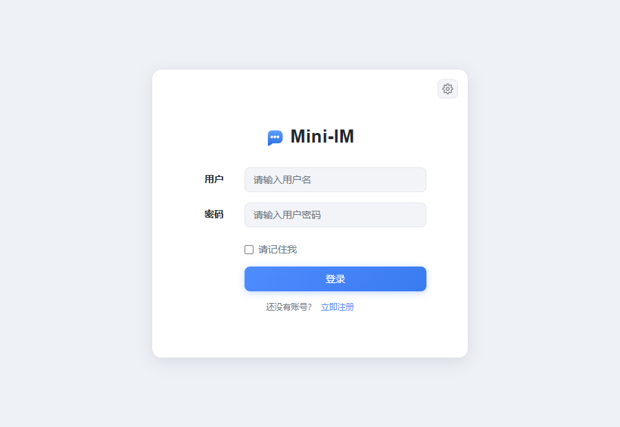 | 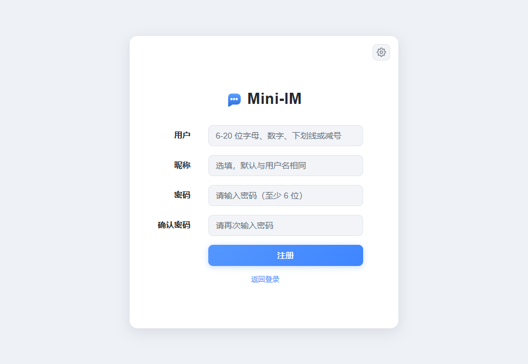 |

登入與註冊在同一個頁面切換：使用者名稱 6-20 位（字母、數字、下劃線或減號），密碼至少 6 位，
暱稱選填、留空時回退為賬號名。勾選「請記住我」會把登入態寫進 `localStorage`，
下次開啟直接進入聊天頁；token 剩餘有效期不足 12 小時時，前端會自動續簽。

同一賬號在別處登入後，舊連線的 token 立即失效，前端會彈出
「賬號在別處登入，嘗試重新登入」並自動清理本地態跳回登入頁（單點登入，見[設計要點](#設計要點)）。

### 2. 搜尋並新增好友

點左上角 `+` 或「新的朋友」裡的按鈕開啟「新增好友」，按賬號 / 暱稱模糊搜尋，
結果裡會標註你與對方的關係（可新增 / 申請中 / 待你處理 / 已是好友 / 已拉黑），
可附帶一句 100 字以內的驗證訊息。


### 3. 新的朋友（處理申請）

對方申請後會實時收到 `friend_request` 事件，左側「新的朋友」出現角標，
列表裡直接「同意 / 拒絕」；同意後雙方即時成為好友，申請方會收到 `friend_accepted` 事件。

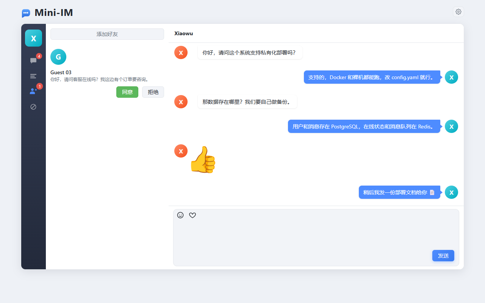

### 4. 聊天

聊天視窗支援文字、emoji 與圖片表情（圖片以 HTML 片段作為訊息內容，`content_type=image`）。
對方不線上時訊息進入離線佇列，上線後按原順序補發；
未讀數由服務端的已讀遊標算出，開啟會話即標記已讀。

| PC 端聊天 | 手機端聊天 |
| --- | --- |
|  |  |

傳送前服務端會校驗**雙方仍互為好友**、**接收方沒有拉黑我**，任一不透過都不轉發也不落庫，
只給傳送方回一個事件並撤回本地樂觀渲染的那條訊息：

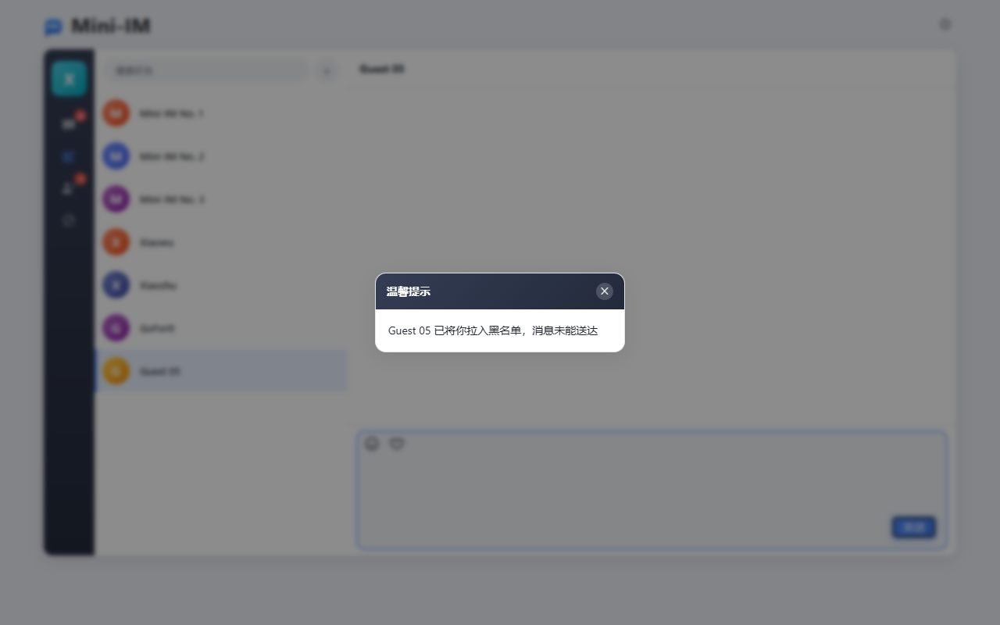

| event | 含義 |
| --- | --- |
| `blacklisted` | 對方已把我拉入黑名單（上圖） |
| `unfriended` | 對方已把我從好友中刪除 |
| `not_friend` | 雙方本就不是好友，或我已刪除對方 |

### 5. 好友管理：刪除 / 拉黑

滑鼠懸停好友條目會出現「拉黑」「刪除」兩個操作，都會二次確認後才執行。
刪除好友是**單向軟刪除**：只清我這一側的列表與聊天記錄，對方不受影響，但雙方都發不出訊息；
再次新增是全新會話。

| 好友列表（懸停出現操作） | 刪除好友確認 |
| --- | --- |
| 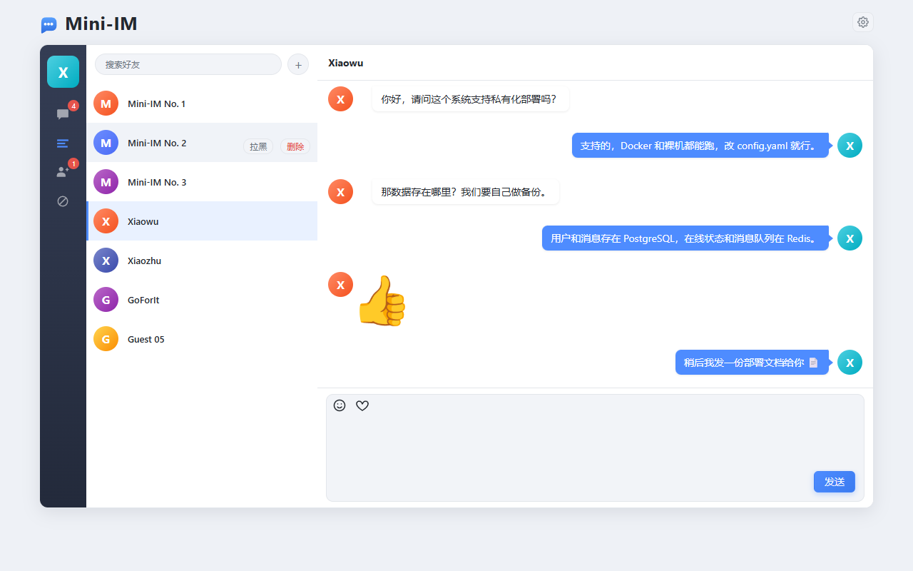 | 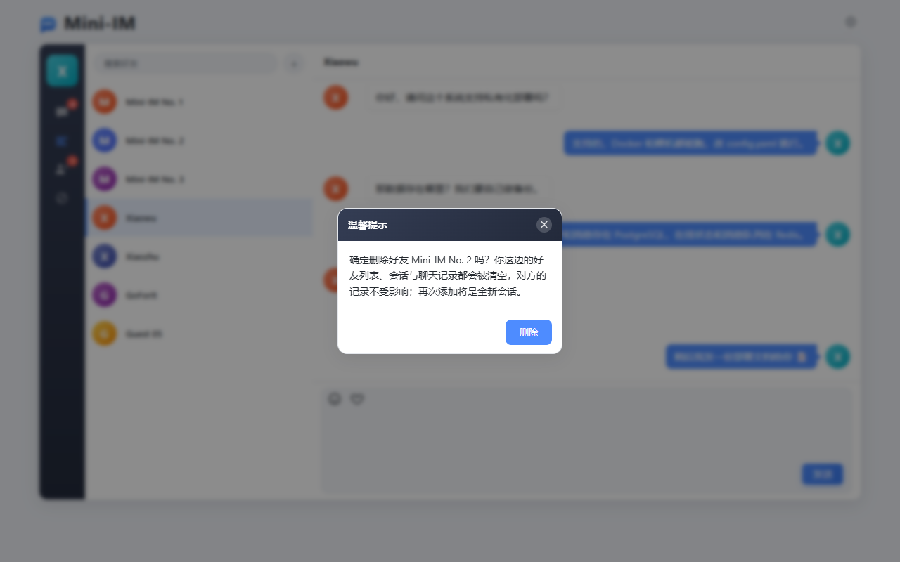 |

拉黑同樣是單向的：被拉黑的人從我的好友列表與會話列表中消失（好友關係與聊天記錄都不刪除），
只攔截「被拉黑方 → 拉黑方」方向的訊息，在「黑名單」頁可以隨時移出、移出後自動恢復。


### 6. 設定：主題 / 字號 / 字重 / 語言

右上角齒輪開啟設定抽屜，改動實時生效並落到 `localStorage`。

| 淺色 | 深色 |
| --- | --- |
| 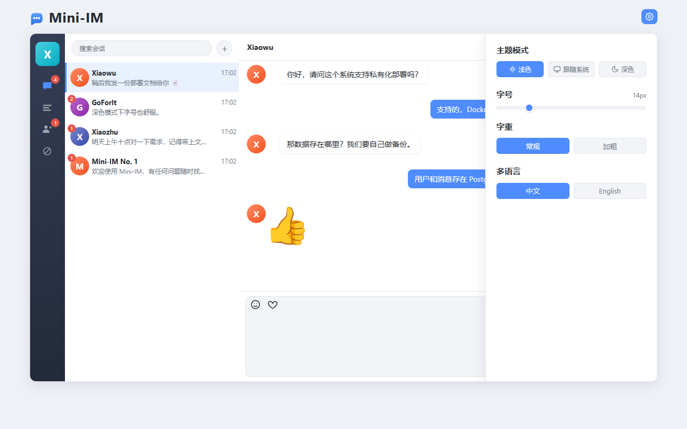 |  |

### 7. 手機端

手機端是同一套頁面的響應式佈局（斷點 `991px`）：左側導航收成窄欄，
點開會話後聊天面板全屏滑入，頂部出現返回箭頭；輸入區是微信風格的單行輸入條，
輸入框字號 ≥16px 以避免 iOS 聚焦時頁面縮放，並監聽 `visualViewport` 做鍵盤避讓。

| 登入 | 會話列表 | 聊天（全屏） | 設定 |
| --- | --- | --- | --- |
|  |  |  |  |

---

## 介面

鑑權：請求頭 `Authorization: Bearer <token>`。

| 方法 | 路徑 | 鑑權 | 說明 |
| --- | --- | --- | --- |
| POST | `/api/register` | 否 | 註冊新賬號（使用者名稱 6-20 位字母、數字、下劃線或減號，密碼 ≥ 6 位） |
| POST | `/api/login` | 否 | 登入，返回 `user` 與 `tokens` |
| PUT | `/api/token` | 是 | 續簽 token |
| POST | `/api/logout` | 是 | 退出登入 |
| GET | `/api/friends` | 是 | 好友列表（不含我拉黑的人） |
| DELETE | `/api/friends/:FID` | 是 | 刪除好友（單向：我的列表與會話清空，對方不受影響） |
| GET | `/api/messages` | 是 | 會話列表，每個物件只取最新一條，帶未讀數（不含我拉黑的人） |
| GET | `/api/chats/:FID` | 是 | 與指定好友的聊天記錄 |
| POST | `/api/read/:FID` | 是 | 把與指定好友的會話標記為已讀 |
| GET | `/api/users?keyword=` | 是 | 按賬號 / 暱稱搜尋使用者，帶與我的關係 |
| POST | `/api/friend-requests` | 是 | 發起好友申請（`{to_id, message}`） |
| GET | `/api/friend-requests` | 是 | 待我處理的好友申請 |
| POST | `/api/friend-requests/:ID/accept` | 是 | 同意好友申請 |
| POST | `/api/friend-requests/:ID/reject` | 是 | 拒絕好友申請 |
| GET | `/api/blacklist` | 是 | 我拉黑的使用者列表（按拉黑時間倒序） |
| POST | `/api/blacklist` | 是 | 拉入黑名單（`{user_id}`，冪等） |
| DELETE | `/api/blacklist/:UID` | 是 | 移出黑名單 |
| GET | `/ws?token=xxx` | 是 | WebSocket 長連線，也相容 Authorization 頭 |
| GET | `/avatar?name=&label=` | 否 | 動態生成 SVG 頭像 |
| GET | `/healthz` | 否 | 健康檢查，返回線上連線數 |
| GET | `/setup` | 否 | 初始化配置嚮導（無配置檔案時）；配置完成後是服務狀態頁 |

### 響應格式

```json
{ "StatusCode": 0, "Message": "請求成功", "Data": {} }
```

| 碼 | 含義 |
| --- | --- |
| `0` | 成功 |
| `-1` | 業務失敗，原因見 `Message` |
| `-10` | 未登入 / 登入態失效 / 賬號在別處登入，前端會自動清理本地態並跳登入頁 |

HTTP 狀態碼固定 200（WebSocket 鑑權失敗除外，返回 401），業務結果只看 `StatusCode`。
無資料時列表介面返回 `[]`，其餘返回 `{}`，不會是 `null`。

### 登入示例

```http
POST /api/login
Content-Type: application/json

{ "username": "ha1234", "password": "123123" }
```

```json
{
  "StatusCode": 0,
  "Message": "登入成功",
  "Data": {
    "user": {
      "id": "364066726138089472",
      "username": "ha1234",
      "nickname": "Xiaoha",
      "avatar": "/avatar?label=Xiaoha&name=ha1234"
    },
    "tokens": { "token": "eyJhbGciOi...", "exp": 1790843147 }
  }
}
```

> `im_user` / `im_friend_request` 的 ID 是雪花 ID（18~19 位），超出 JavaScript 安全整數範圍（2^53），
> 因此 JSON 中一律按**字串**輸出；訊息主鍵是 UUID v7，本身就是字串。
> `create_time`、`msg_count` 等小整數仍是數字；`content_type` 是字串標識（見下）。

聊天記錄 `GET /api/chats/364066726138089472` 返回陣列，元素在實體欄位之外額外帶兩個只讀欄位：

```json
{
  "id": "01a0f691-d2f8-7a3d-9e2f-4b6a8c1d5e70",
  "content_type": "text",
  "content": "你好 👋",
  "user_id": "364066726138089472",
  "friend_id": "1",
  "create_time": 1790843147,
  "type": 1,
  "user": { "id": "1", "nickname": "Xiaoha", "avatar": "/avatar?..." }
}
```

`type` 為 `1` 表示自己發出、`2` 表示對方發來，僅在介面返回時計算。
列表按 `create_time` 倒序，前端會 reverse 成正序渲染，單會話最多返回 200 條。

會話列表 `GET /api/messages` 的元素形如：

```json
{
  "time": 1790843147,
  "message": "你好 👋",
  "content_type": "text",
  "uid": "364066726138089472",
  "msg_count": 2,
  "user": { "id": "364066726138089472", "nickname": "Xiaoha", "avatar": "/avatar?..." }
}
```

`uid` 是對方的 ID，`msg_count` 是服務端按已讀遊標算出的未讀數，呼叫 `POST /api/read/:FID` 後清零。

### WebSocket

連線 `ws://127.0.0.1:8280/ws?token=<token>`，建立後會先收到一條
`content` 為 `socket服務連線成功` 的訊息，隨後依次補發積壓的離線訊息。

上行報文：

```json
{
  "sender": "",
  "recipient": "2",
  "content": "你好",
  "content_type": "text",
  "subjoin": { "avatar": "", "nickname": "" }
}
```

`sender`、`time`、`subjoin` 由服務端覆蓋填寫，客戶端傳什麼都無效；
`content_type` 是字串標識：`text` 文字、`image` 圖片（內容為 HTML 片段），
未知值由服務端歸一化為 `text`。
單條報文上限 8KB，超過會被斷開連線。下行報文結構相同。

傳送前服務端會依次校驗：**雙方仍互為好友**（任一方刪除好友後訊息都不再可達）、
**接收方沒有拉黑我**；任一不透過都不轉發、不落庫，並給傳送方回一個
`not_friend` / `unfriended` / `blacklisted` 事件。

此外服務端會主動推送**業務事件**，報文只有 `event` 與 `data` 兩個欄位，
前端收到後重新整理對應列表即可（離線時丟棄，登入後拉介面依舊能看到）：

```json
{
  "event": "friend_request",
  "data": { "id": "364070295146860544", "nickname": "AddTest", "avatar": "/avatar?...", "message": "你好" }
}
```

| event | 觸發時機 | data 攜帶 |
| --- | --- | --- |
| `friend_request` | 有人申請加我為好友 | 申請人資料 + `message` |
| `friend_accepted` | 我發出的申請被同意（已互為好友） | 同意者資料 |
| `not_friend` | 我發的訊息因我已刪除對方（或雙方本就不是好友）而未送達 | 對方資料（訊息已被服務端丟棄） |
| `unfriended` | 我發的訊息因對方已把我從好友中刪除而未送達 | 對方資料（訊息已被服務端丟棄） |
| `blacklisted` | 我發的訊息因被對方拉黑而未送達 | 拉黑方資料（訊息已被服務端丟棄） |

---

## 端到端迴歸

`tools/e2e` 是一個只依賴被測介面的迴歸指令碼（HTTP + WebSocket），
覆蓋「註冊 → 登入 → 搜尋 → 加好友 → 線上訊息 → 聊天記錄 → 已讀 → 離線訊息 → 登入態」全鏈路，
以及拒絕重申請、互相申請直接成為好友、併發訊息、超長訊息、偽造 sender 等邊界。

```bash
go run ./tools/e2e                  # 全部場景
go run ./tools/e2e -scenario=core   # 只跑主鏈路
go run ./tools/e2e -scenario=edge   # 只跑邊界 / 併發
go run ./tools/e2e -addr=http://127.0.0.1:8280
```

指令碼會真實註冊固定賬號（`carol_01` `bob_01` `dave_01` `erin_01` `frank_01` `nick0_01`，密碼統一 `123456`）並寫入訊息，
斷言依賴「賬號此前不存在、彼此尚不是好友」，因此**請在乾淨庫上執行**，重複執行前先清庫：

```bash
psql -h 127.0.0.1 -U postgres -d "mini-im" -c \
  "TRUNCATE im_message, im_friend, im_friend_request, im_read_state, im_blacklist, im_contact_state, im_user;"
redis-cli -n 1 flushdb
```

全部透過時退出碼為 `0`，任一項失敗為 `1`，可直接接入 CI。
當前基線：**94 項斷言全部透過**。

---

## 專案結構

```
main.go                 入口：載入配置（缺失則先進嚮導）→ 初始化元件 → 啟動服務 → 優雅退出
config.yaml             本地配置（不入庫：嚮導寫出或複製模板生成）
config.example.yaml     配置模板（入庫）：初始化嚮導寫回 config.yaml 時的底稿
docker-compose.yml      PostgreSQL + Redis
conf/                   配置載入與校驗、按模板渲染寫回、Redis key 生成
setup/                  首次啟動的初始化配置嚮導（頁面 + 連線探測 + 寫回）
db/                     GORM 連線與自動遷移、Redis 客戶端、演示資料
model/                  實體：im_user / im_friend / im_friend_request / im_message / im_read_state / im_blacklist / im_contact_state
dao/                    資料訪問
service/                業務：鑑權、會話、已讀、線上狀態、訊息佇列
api/handler             HTTP 處理器
api/middleware          鑑權、跨域
ws/                     WebSocket 連線中心
task/                   後臺訊息落庫任務
route/                  路由註冊
pkg/                    統一響應、JWT、HTTP 工具、雪花 ID、UUID v7、埠錯誤提示
web/                    前端靜態頁
docs/images/            README 截圖
tools/                  維護指令碼：e2e 迴歸、favicon 生成、Bootstrap CSS 精簡
```

依賴方向單向向下：`api / ws / task → service → dao → db`，不反向引用。

### 前端資源

前端沒有構建流程，頁面只依賴 **Vue 2 + Axios**，沒有引入 jQuery 和 Bootstrap JS
（Bootstrap 僅用其 CSS 的網格 / 按鈕 / 表單部分）。

右上角齒輪開啟的設定抽屜裡，各項設定都存在 `localStorage`，並落到 `<html>` 的屬性上：

| 設定 | key | 落地方式 |
| --- | --- | --- |
| 主題（淺色 / 跟隨系統 / 深色） | `mini-im-theme` | `data-theme` |
| 語言（中文 / English） | `mini-im-lang` | `lang` |
| 字號（滑桿 10~30px） | `mini-im-font-size` | 直接寫根字號內聯樣式（`rem` 基準），`data-font-size` 留記號 |
| 字重（常規 / 加粗） | `mini-im-font-weight` | `data-font-weight`，切 `--fw-base` / `--fw-medium` / `--fw-bold` |

CSS 的字號統一寫成 `rem`（基準 14px，即預設字號與改造前畫素級一致），
`common.css` 開頭把 Bootstrap 裡幾個固定 `px` 的基礎字號（`body` / `.btn` / `.form-control`）
也改寫為 `rem`，因此切字號只縮放文字，間距與圖片尺寸不變；
字重則透過 `--fw-*` 變數控制，加粗檔位下標題層級同步上浮。

設定抽屜本身刻意保留固定 `px` 字號：面板就是「調字號」的地方，拖動滑桿時它自己不能跟著縮放，
否則滑桿會上下跳動；面板外的聊天介面是實時預覽，拖到哪文字就變到哪。

`bootstrap.min.css` 雖是完整包，但已按「當前頁面實際用到的 class」裁剪到約 12KB
（原始 121KB）。裁剪指令碼在 `tools/`，重新下載完整版 Bootstrap 後跑一次即可：

```bash
node tools/trim-bootstrap.cjs            # 空跑，列印統計與 5 項校驗
node tools/trim-bootstrap.cjs --write    # 校驗透過後寫入
```

裁剪按選擇器分支進行：分支裡含有當前 DOM 不存在的 class 才會被刪除，
且 `@media` 遞迴、`@keyframes` 整塊保留，因此對現有頁面渲染等價。

導航欄與設定面板的圖示用內聯 SVG 實現，不再需要 Glyphicons 字型；
`web/favicon.ico` 由 `go run ./tools/genfavicon.go` 生成。

### 資料表

| 表 | 欄位 |
| --- | --- |
| `im_user` | `id`(雪花) `username`(唯一) `password`(bcrypt) `nickname` `avatar` `create_time` `update_time` |
| `im_friend` | `id`(自增) `user_id` `friend_id` `add_time`，兩列均有索引（刪除好友不刪行） |
| `im_friend_request` | `id`(雪花) `from_id` `to_id` `message` `status` `create_time` `update_time` |
| `im_message` | `id`(UUID v7) `content_type`(字串：`text` / `image`) `content` `user_id` `friend_id` `create_time`（只增不改） |
| `im_contact_state` | `id`(自增) `user_id` `peer_id` `removed` `clear_time`，`(user_id, peer_id)` 唯一 |
| `im_read_state` | `id`(自增) `user_id` `peer_id` `read_time` `update_time`，`(user_id, peer_id)` 唯一 |
| `im_blacklist` | `id`(自增) `user_id` `blocked_id` `add_time`，`(user_id, blocked_id)` 唯一，`blocked_id` 建立索引 |

`im_friend_request` 上 `(from_id, to_id)` 唯一、`(to_id, status)` 建立索引：
同一對使用者只保留一行，重複申請走 upsert；`status` 為 `1` 待處理、`2` 已同意、`3` 已拒絕。

`im_blacklist` 是**單向**關係：`user_id` 拉黑了 `blocked_id`。拉黑後：

- 被拉黑的人從我的**好友列表**與**會話列表**中消失，只保留在黑名單列表裡
  （好友關係與聊天記錄都不刪除，只是列表介面按黑名單過濾，移出後自動恢復）；
- 只攔截「被拉黑方 → 拉黑方」這個方向的訊息投遞，傳送方會收到 `blacklisted` 事件；
- 兩人之間待處理的好友申請會被清理，被拉黑方無法再向我發起好友申請。

`im_contact_state` 記錄「我這一側」的聯絡人狀態，每個 `(user_id, peer_id)` 一行：

- `removed`：我已把對方從好友中移除（我的好友列表 / 會話列表過濾掉他，且雙方都發不出訊息）；
- `clear_time`：我清空與該使用者會話的時間點，早於它的訊息不再出現在我的會話列表 / 聊天記錄裡
  （訊息行本身不動，對方仍看得到自己的記錄）。

刪除好友、重新加回來、清空會話都只寫這張表，`im_friend` 行始終保留。

時間欄位統一為 Unix 秒。好友關係按 `(user_id = ? OR friend_id = ?)` 雙向匹配，
一條記錄即可表達雙向關係；「誰刪了誰」這類單側狀態在 `im_contact_state`。

### Redis key

字首取 `app.name`（`config.example.yaml` 中為 `mini-im`），生成邏輯集中在 `conf/config.go`。

| Key | 型別 | 用途 |
| --- | --- | --- |
| `<prefix>:auth_token:<uid>` | string | 當前有效 token，TTL = `jwt.expire`，用於單點登入 |
| `<prefix>:online_users` | set | 線上使用者 ID |
| `<prefix>:msg_queue` | list | 待落庫訊息，`LPUSH` 入隊 / `BRPOP` 出隊 |
| `<prefix>:msg_queue_error` | list | 落庫失敗的訊息，便於補償 |
| `<prefix>:offline:<uid>` | list | 離線訊息，`LPUSH` + `RPOP` 保證原順序 |

---

## 設計要點

**主鍵選型**
`im_user` / `im_friend_request` 用雪花 ID（`pkg/snowflake`，41 位毫秒時間戳 + 10 位節點號 + 12 位序列號，
起始時間 2024-01-01 UTC）；`im_message` 用 UUID v7（`pkg/uuidv7`，48 位毫秒時間戳 + 4 位版本號 +
12 位序列號 + 2 位變體 + 62 位隨機數，遵循 RFC 9562）。
兩類主鍵都由應用側生成（雪花欄位標註 `autoIncrement:false`，UUID 欄位是字串主鍵），
插入前由模型的 `BeforeCreate` 鉤子補齊，
因此 ID 在落庫前就已確定、且整體按時間遞增（B 樹索引表現為順序追加）；
發生時鐘回撥時一律沿用上次時間戳繼續自增，保證同一程序內不重複、不回退，單機每毫秒最多產出 4096 個。
對外一律以字串形式序列化：雪花 ID 避免前端 JS 大整數精度丟失（見上文登入示例說明），UUID 本身就是字串。

訊息是三張表裡增長最快、且只增不改的一張，主鍵換用 UUID v7 後不再需要節點號協調
（`snowflake.node_id` 隻影響使用者與好友申請），多例項部署可直接水平擴容，也不存在 64 位容量問題；
代價是主鍵寬一倍（16 位元組）。同毫秒內序列號遞增（而非純隨機）保留了「按 ID 排序即按時間排序」的性質，
`im_message` 的排序索引因此不會因隨機主鍵而頻繁頁分裂。
`im_friend` / `im_read_state` 仍是資料庫自增，無需全域性唯一。

**加好友**
搜尋（`username` / `nickname` 模糊匹配，排除自己，`ILIKE` 且轉義 `%` `_`）→ 發起申請 →
對方同意後寫入一條 `im_friend` 記錄（一條記錄即雙向關係）。
同一對使用者只有一行申請，重複申請走 `ON CONFLICT` upsert 並重新置為待處理，驗證訊息上限 100 字；
若「對方已申請我」時我再申請，則等價於雙方互相確認，直接成為好友。
申請與同意都會透過 `service.Notify` 推給線上使用者，推送實現（`*ws.Hub`）在 `main` 中注入：
`service.SetNotifier`，因此業務層不必反向依賴 ws 包。
被拒絕的申請不會推送事件，申請方需要自行拉介面或再次申請。

**刪好友（單向，不刪資料）**
`DELETE /api/friends/:FID` 不動 `im_friend` 行，只在 `im_contact_state` 寫入
`(user_id = 我, peer_id = 對方, removed = true, clear_time = 現在)`：

- 我這一側：好友列表 / 會話列表不再有對方，`GET /api/chats/:FID` 只返回 `clear_time`
  之後的訊息（此刻為空，所以「重新加回來是空的」）；
- 對方那一側：好友列表、會話、聊天記錄都不受影響，只是雙方都發不出訊息
  （`IsFriend` 雙向校驗），對方傳送時會收到 `unfriended` 提示；
- 重新加為好友時清掉雙方的 `removed`，但保留各自的 `clear_time`：
  刪過好友的一方是全新空會話，另一方原本的記錄不會被翻出來；
- 和拉黑一樣，刪除與清空都隻影響「我這一側」，訊息行本身始終保留。

**單點登入**
登入簽發 token 後寫入 `<prefix>:auth_token:<uid>` 覆蓋舊值，校驗時比對 Redis 中的值。
舊 token 再訪問返回 `-10` 與「賬號在別處登入」，前端自動跳登入頁。
同一賬號的 WebSocket 長連線不受影響（建連時校驗一次）。

**訊息鏈路**
WebSocket 收到上行訊息後，服務端補全傳送者資料 → 扇出給接收方的全部連線 →
對端無活躍連線則寫入離線佇列 → 同時投遞到待落庫佇列，由後臺任務阻塞消費寫入 PostgreSQL。
落庫是非同步的，正常毫秒級完成；失敗的訊息轉入錯誤佇列而非丟棄。
`recipient` 非法或等於自己時直接丟棄該報文。

**未讀數**
`im_read_state` 記錄每個會話的已讀遊標（`read_time`），未讀數 = 對方發來且晚於遊標的訊息條數，
`POST /api/read/:FID` 推進遊標（`GREATEST` 保證併發下只前進不後退）。
之所以記遊標而不是給每條訊息打已讀標記：訊息是非同步落庫的，用遊標可以避免
「標記已讀發生在訊息落庫之前」而產生的假未讀。遊標缺失時回退到「我在該會話中最後一次發言時間」，
避免把早已看過的歷史訊息全算成未讀。

**線上狀態**
Hub 維護「使用者 → 連線集合」，同一賬號可多端線上。首個連線建立時標記線上，
最後一個連線斷開才標記離線。

**前端佈局**
桌面端與移動端是同一套 DOM，靠 `@media (max-width: 991px)` 切換：
桌面端左側固定 650px 高的卡片佈局，移動端改成 `100svh` 縱向 flex，
左側導航收成 56px 窄欄、聊天面板絕對定位全屏滑入（`.app-mobile-chat`）。
移動端 `.right-box` 必須顯式 `height: auto` 復位桌面端的 `--Height`，
否則 `top/bottom` 同時生效時 `bottom` 被忽略，聊天面板只佔 650px、底部會露出導航欄。

**連線保活**
服務端 54s 發一次 ping，客戶端 60s 內無響應即判定斷線；單次寫超時 10s，
傳送緩衝寫滿時斷開該連線而不阻塞其他使用者。

**頭像**
`/avatar?name=&label=` 按使用者名稱雜湊出固定配色，取 `label` 首字元渲染 SVG 並快取 24h，
因此服務不依賴任何圖片資源，註冊賬號的頭像即指向該介面。

**emoji**
PostgreSQL 原生支援四位元組 UTF-8，直接明文儲存。舊 MySQL 實現裡的 `[\uXXXX]`
轉義與還原邏輯已整體移除。

---

## 部署提示

- 關閉 debug：`IM_RUN_MODE=release`，同時 gorm 日誌降為 warn 級別
- 反向代理需要透傳 WebSocket 升級頭 `Upgrade` / `Connection`，且不要設定過短的讀超時
- 應用監聽 `SIGINT` / `SIGTERM`，退出時等待 10s 讓在途請求結束並關閉資料庫連線
- 配置就緒後 `/setup` 只是服務狀態頁，但仍建議在閘道器層攔掉它：初始化嚮導不應暴露到公網
  （生產環境不要把 `SETUP_FORCE` 留在啟動環境裡）

---

## 更新日誌

版本歷史見 [CHANGELOG.md](CHANGELOG.md)，遵循 [語義化版本](https://semver.org/lang/zh-CN/)。

## 許可

[MIT](LICENSE) © 2026 kite88
